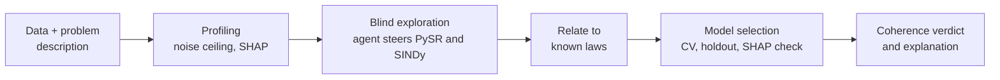

# Syxplain

[](https://github.com/HUN-REN-AI1Science/syxplain/actions/workflows/ci.yml)
[](LICENSE)
[](https://www.python.org/downloads/release/python-3100/)
[](https://nodejs.org/)

**Interpretable equations from your data, checked against the evidence and related to
known science.**

Syxplain is an AI-scientist agent for equation discovery. You give it a table of
measurements, the quantity you want to explain, and a sentence about the problem. It
searches for compact formulas with symbolic regression ([PySR](https://github.com/MilesCranmer/PySR))
steered by an LLM agent, and then reports:

- **the best equation**, chosen by cross-validation and scored once on a holdout set, with
  the simplest adequate model preferred
- **how far the data allows**: a noise ceiling estimates the best accuracy any model could
  reach
- **whether the evidence agrees**: SHAP effects, the holdout, parameter identifiability and
  known laws are each checked against the headline equation
- **its relation to known science**: whether the equation rediscovers a published or
  textbook law, extends one, or describes something new
- **a plain-language explanation** of what the equation means and where it falls short

It works on cross-sectional data (soil chemistry, materials, connectomics) and on time
series, where it adds lagged and period features and SINDy rate laws.

## How it works



1. **Profiling.** Feature importance, interactions, partial-effect shapes (SHAP), and a
   noise ceiling for the best achievable accuracy.
2. **Blind exploration.** The agent never sees known laws during the search, so existing
   knowledge cannot bias it. It designs formulas, gets diagnosed reasons why each one
   falls short (wrong shape, missing variable, unidentifiable parameters), and launches
   targeted PySR searches.
3. **Relation to known laws.** Only afterwards are the discoveries compared with classic
   named laws and with published laws found by a literature scout. Each discovery is
   classed as equivalent, similar, partial or different.
4. **Selection and coherence.** Code picks the headline model and checks it against every
   line of evidence. The LLM explains, but does not overrule, the computed verdicts.

[docs/how-it-works.md](docs/how-it-works.md) gives the full description.

## Quick start

You need Docker with Compose v2 and an OpenAI API key. No HPC cluster is required.

```bash
git clone https://github.com/HUN-REN-AI1Science/syxplain.git
cd syxplain
cp .env.example .env          # then set OPENAI_API_KEY in .env
docker compose up --build
./dev/create-dev-user.sh      # in a second terminal, once Keycloak is up
```

Open http://localhost:5173 and log in as `dev@example.com` / `Dev-password-1`. Upload one
of the [example datasets](data/) and start an analysis.

The development stack contains:

| Service | URL |
|---|---|
| Web app (Vite, hot reload) | http://localhost:5173 |
| Backend API (hot reload) and API docs | http://localhost:8000, http://localhost:8000/docs |
| Keycloak admin console (`admin`/`admin`) | http://localhost:8080/keycloak/admin |
| Local Slurm emulator | http://localhost:6820 |
| PostgreSQL | localhost:5432 |

### Real symbolic regression on your machine

By default, the local Slurm emulator answers PySR searches with quick least-squares fits.
This is enough for UI and pipeline work, but the equations are not real PySR output. To
run real PySR searches locally:

```bash
LOCAL_PYSR=true docker compose up --build
```

The first build installs Julia and PySR into the emulator image, which takes 10–20
minutes. `SLURM_CPUS` (default 4) sets the CPUs per search, as on a cluster.

### Your own Slurm cluster

For production-sized searches, Syxplain submits PySR jobs to a Slurm cluster through the
slurmrestd REST API. Workers run in a Singularity image. [docs/slurm.md](docs/slurm.md)
covers the setup.

## Example datasets

[`data/`](data/) contains ready-to-run examples: each folder holds a data file and a
`problem_description.json` with the description, target and feature descriptions to
enter in the app. [data/README.md](data/README.md) gives their sources and licenses.

## Programmatic API

Create an API key under **Profile → API Keys**, then:

```bash
export SYXPLAIN_API_KEY=syxp_...
python examples/api_client.py data/example_1 --base-url http://localhost:8000
```

[docs/api.md](docs/api.md) describes the endpoints. The backend serves interactive docs at
`/docs`.

## Development

| Task | Command |
|---|---|
| Backend tests | `uv run --with-requirements requirements.txt pytest` |
| Python lint/format | `ruff check . && ruff format --check .` |
| Frontend lint/types/format | `cd frontend && npm run lint && npm run typecheck && npm run format:check` |
| Classic-law screen, no services | `python dev/run_worker_task.py --task classic --example 1` |
| Agent on an example (needs an LLM key; no cluster, DB or auth) | `python dev/try_discovery_agent.py --example 1` |

The tests need no database, cluster or LLM key. [CONTRIBUTING.md](CONTRIBUTING.md) covers
setup, conventions and pull requests.

### Repository layout

```
backend/        FastAPI app: API, orchestration, discovery agent (services/discovery/)
frontend/       React + TypeScript web app (Vite, PrimeReact, Tailwind)
slurm_worker/   Compute worker (PySR) and its Singularity image definitions
keycloak/       Realm export and login/email theme
dev/            Local Slurm emulator, dev login script, local runners
docs/           How it works, configuration, deployment, Slurm, API
data/           Example datasets
examples/       API client example
```

## Documentation

- [How it works](docs/how-it-works.md)
- [Configuration](docs/configuration.md): every environment variable
- [Deployment](docs/deployment.md): production with Docker Compose, TLS, Keycloak
- [Slurm](docs/slurm.md): running the compute on your own cluster
- [API](docs/api.md)

## Citing

If you use Syxplain in your research, please cite it using
[CITATION.cff](CITATION.cff); GitHub's "Cite this repository" button gives BibTeX and
APA. A paper describing the method is in preparation.

## Contributing and security

Contributions are welcome: see [CONTRIBUTING.md](CONTRIBUTING.md) and the
[Code of Conduct](CODE_OF_CONDUCT.md). Report vulnerabilities privately, as described
in [SECURITY.md](SECURITY.md).

## License and acknowledgements

Syxplain is released under the [MIT License](LICENSE).

It is developed by the AI1Science group of the HUN-REN Hungarian Research Network and
Óbuda University.
