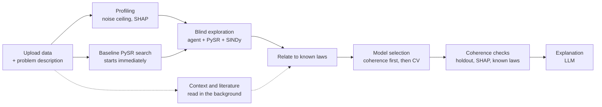

# How Syxplain works

Syxplain takes a table of measurements, a target column and a short description of the
problem, and returns interpretable equations for the target. Each equation comes with
evidence for and against it, how it relates to known scientific laws, and a
plain-language explanation.

The pipeline combines an LLM agent (reasoning, planning, explanation) with numerical
tools (symbolic regression, least-squares fitting, cross-validation, SHAP, SINDy). The
rule throughout is that code decides, and the LLM proposes and explains:
- Which model is the headline, how well it fits, and whether the evidence agrees are
  all computed.
- The LLM chooses what to try next and puts the results into words.



## 1. Baseline search

Before any reasoning starts, a baseline PySR search is submitted:
- it uses all continuous features
- an LLM chooses the operators from the feature plots

It starts first so that the compute queue wait overlaps with the agent's work.

Integer-coded categories (soil type codes and the like) are never used as magnitudes, only
as `level(x, k)` indicators.

## 2. Profiling

The agent profiles the data with:
- correlations and mutual information
- random-forest permutation importance
- a noise ceiling: the out-of-fold random-forest R², roughly the best accuracy any
  model can reach on this data
- SHAP on that forest: feature importance, interacting feature pairs (candidates
  for product terms and multiplicative laws), and each feature's partial-effect shape
  with the other features accounted for

SHAP plots are shown to the agent as images: a summary plot and dependence plots of the
top features, coloured by their interaction partner. From these the agent can read
plateaus, bends and outliers directly, without relying on a shape label.

`DISCOVERY_SHAP_IMAGES=false` gives the agent text SHAP only.

SHAP runs in the backend in seconds (rows, trees and the interaction sample are capped).

## 3. Blind exploration

Exploration is blind to known laws, so existing knowledge does not bias the search:
- the agent has no access to the classic law catalog or the literature
- shape labels name no model family

The agent designs its own formulas from the shapes and interactions it sees. Every
candidate is fitted the same way, and comes back with diagnosed reasons it falls
short:
- wrong curve shape, and where
- a missing variable, and which one
- variance growing with the value
- unidentifiable parameters
- "matches the noise ceiling"

Guided by those reasons, the agent launches targeted PySR searches. For each one it
chooses:
- the feature subset
- the operators
- the target transform
- warm-start guesses: its best formulas so far, or, when it has none, the strongest SHAP
  interaction as `c0 + c1*a*b` and `c0 + c1*a/b`

It compares the results with its own formulas.

It records its findings in a lab notebook (rejected forms with reasons, insights,
data issues), which the explanation step reads.

### Time-ordered data

When the rows are measurements along time, the run detects the time structure. The
agent can confirm or override the detection.

Long series along time (annual GPP, monthly groundwater levels; at least 20 points
per series) get a feature stage before the first PySR search. The measurements need not be
evenly spaced: the step is the typical distance between measurements, and a value "K steps
earlier" is read between the two measurements around that moment when they are close
together (a long gap gives a missing value). It covers the case where the target depends
on earlier conditions as well as current ones.

By default the features come from the orders of an automatic ARIMA search (`auto_arima`,
with the current features as regressors) on the training rows:
- orders p and d (and one season earlier for a seasonal fit) name the target's earlier
  values;
- order q names the earlier errors of that fit. An error is the measured value minus the
  value predicted one step ahead from earlier measurements, so it is known before the row
  it is used on.

The ARIMA model itself is never a candidate equation; symbolic regression decides which
of the features an equation uses.

`DISCOVERY_SERIES_FEATURES` selects the source. With `llm`, an LLM proposes lags and
aggregates over earlier periods of any column, code computes and measures them, and an LLM
selects at most a handful. With `both`, the LLM is also shown the orders and what the fit
leaves open (memory at longer distances, memory left in the errors, signs of nonlinear
dynamics, as numbers and as a picture), adds features the fit cannot give, and writes a
short note for the agent that steers the searches.

For series, the holdout is chronological. A random split would let every held-out
step sit between training steps, which measures interpolation rather than prediction
forward in time.

Rate laws (how a state changes, `d(target)/dt = f(state, inputs)`) are searched with
SINDy:
- sparse regression over a library of named terms, swept from the simplest law to the
  fullest
- each law is integrated from every trajectory's start, because a law that fits the
  derivatives can still drift or blow up
- SINDy takes seconds and runs in the backend

## 4. Context, literature and known laws

Three readings run in the background from the start of the run. None of them reaches the
agent; they are used only after exploration.

- The context: an LLM reads the project description and the meaning and unit of the
  target, and returns the realistic limits of the target when they follow from what it is
  (a concentration is not negative, a percentage lies between 0 and 100). It does not
  guess a typical range.
- The web literature research (the default): the main model searches the web and
  returns published laws solved for the target, statements about the target, and
  relationships among the other variables. Each statement carries the conditions under
  which its source states it and its validity for the system the data describes: `yes`,
  `unknown` or `no`.
- Supplied literature: text you give (papers, notes, reports; up to 60 000 characters)
  is read by the main model without a web search. It returns the same three things, and
  its statements are treated as valid.

Either kind of literature research can be off, but not both.

A statement is one of four kinds:
- a variable is not a cause of the target
- the target rises or falls with a variable
- a quantity tends to a limit when a variable becomes large or goes to zero
- the ranges in which such systems are operated

After exploration the discoveries are compared with existing knowledge:
- Classic named laws, screened on the variables the discoveries use: Mitscherlich,
  Michaelis-Menten/Langmuir, Freundlich/power, logistic, Gompertz,
  linear/quadratic-plateau, Gaussian peak, Mitscherlich-Baule, Cobb-Douglas, and others.
- Laws of the literature, fitted with the published constants as starting values.

Code compares each discovered equation with each known law through their predictions.
The relation is one of:

| Relation | Meaning |
|---|---|
| equivalent | The same law in another algebraic form, i.e. a rediscovery |
| similar | The predictions agree closely |
| partial | The law describes some of the variables; the discovery adds the others |
| different | A new relationship |

Code also records whether the law fits better, as well, or worse than the discovery,
beyond noise.

Relationships among the other variables are measured on the held-out rows, as
published and with their constants fitted again. A relationship that holds says the
literature describes the context of your data; one that does not is a hint that the
context differs. A relationship that holds is also substituted into a law for the target,
and the composed law is fitted.

## 5. Model selection

Code, not an LLM, picks the headline model among the discovered equations. The
selection is coherence first, metric second:
1. Guards remove models that cannot be recommended (a failed fit, a cross-validated R²
   not above zero, parameters the data do not determine).
2. Every equation is tested against the statements. It conflicts with the context when,
   for values of its variables inside the range of the data, it leaves the realistic
   limits of the target or the measured range of the target by a wide margin. Equations
   that conflict with the context, or with a statement of validity `yes`, are removed.
3. The remaining models are ranked by 5-fold cross-validation on the training rows. All
   models within one standard error of the best are equally good.
4. Statements of validity `unknown` never remove a model. They decide only between
   equally good models.
5. Among the equally good models the agent's first recommendation wins, otherwise the
   simplest.

Known laws are references. One becomes the headline only when no discovered equation is
coherent or usable.

The equation with the best score overall is kept beside the headline when it conflicts
(the *challenger*), with the gap between the two in standard errors. When the challenger
uses a variable that the literature calls "not a cause", code measures how much of what
the headline leaves unexplained that variable explains. At least half means the data
speak against the literature; less means the better score is more likely a wrong
relationship. This reading is a hint and never changes the selection.

The 20% holdout is scored once, at the end. Datasets under 40 rows use cross-validation
only.

The headline equation is then checked against SHAP. For each important feature, the
check asks whether the equation's effect follows the forest's SHAP effect:
- agrees
- disagrees
- opposite
- the feature is ignored

Misses are reported as limitations.

## 6. Coherence

The results page asks whether the independent lines of evidence agree on the headline.
Code checks it against:
- the noise ceiling
- the holdout (generalization gap)
- the SHAP effects
- the published and named laws: a known law that fits better than the discovery is a
  caution; a rediscovered law agrees
- the statements of the context and the literature, and the challenger when it scores
  clearly better
- the literature's relationships among the other variables, as measured on the data
- the statements of the web literature research of validity `unknown` or `no`
- its own parameters: are they determined by the data, and defined on every row?
- the agent's conclusion

Each check comes out as agrees, caution or conflict, and the worst one is the overall
verdict.

The statements of the context and the literature are tested on ordinary equations. Rate
laws are selected by their own protocol, without these statements.

## 7. Explanation

The explanation LLM writes the report:
- what the headline equation says
- how it relates to known laws
- its limitations

It also adds what code cannot judge: whether each effect direction and the limiting
behaviour are plausible in the domain. It may not override the computed checks.

## Budgets and failure handling

The agent is bounded by a budget (`DISCOVERY_*` settings, see
[configuration.md](configuration.md)). These are ceilings; the agent stops earlier when
it is done.

If the agent fails, the run still finishes with the baseline search, compared with the
known laws as usual.

## Cost per analysis

Every LLM call of a run is counted and priced:
- tokens per model, including cached and reasoning tokens
- web searches

Each run logs one line and stores the same summary under `results.usage`:

```bash
docker logs syxplain-backend 2>&1 | grep "ANALYTICS run_usage"
# ANALYTICS run_usage {"run_id":"...","outcome":"completed","models":{"gpt-4o":{"calls":17,...,"cost_usd":0.41}},"total_cost_usd":0.41,...}
```

Prices for OpenAI models are built in. Other models are priced with `LLM_PRICES_JSON`.

## Where things live

| Step | Code |
|---|---|
| Pipeline orchestration | `src/backend/services/orchestrator_service.py` |
| Agent and its tools | `src/backend/services/discovery/agent.py`, `tools.py`, `session.py` |
| Fitting, CV, diagnostics | `src/backend/services/discovery/fitting.py`, `selection.py` |
| Profiling and SHAP | `src/backend/services/discovery/profiling.py` |
| Time series, features, SINDy | `series.py`, `features.py`, `feature_stage.py`, `temporal.py`, `sindy.py` |
| Known laws | `families.py`, `literature.py`, `relate.py` |
| Context and literature statements, relationships | `literature_coherence.py`, `formula_space.py` |
| Orders of the automatic ARIMA fit | `orders.py` |
| Headline, coherence | `report.py`, `coherence.py` |
| LLM prompts (DSPy signatures) | `src/backend/infrastructure/llm/signatures.py` |
| PySR worker | `src/slurm_worker/tasks/pysr_task.py` |
