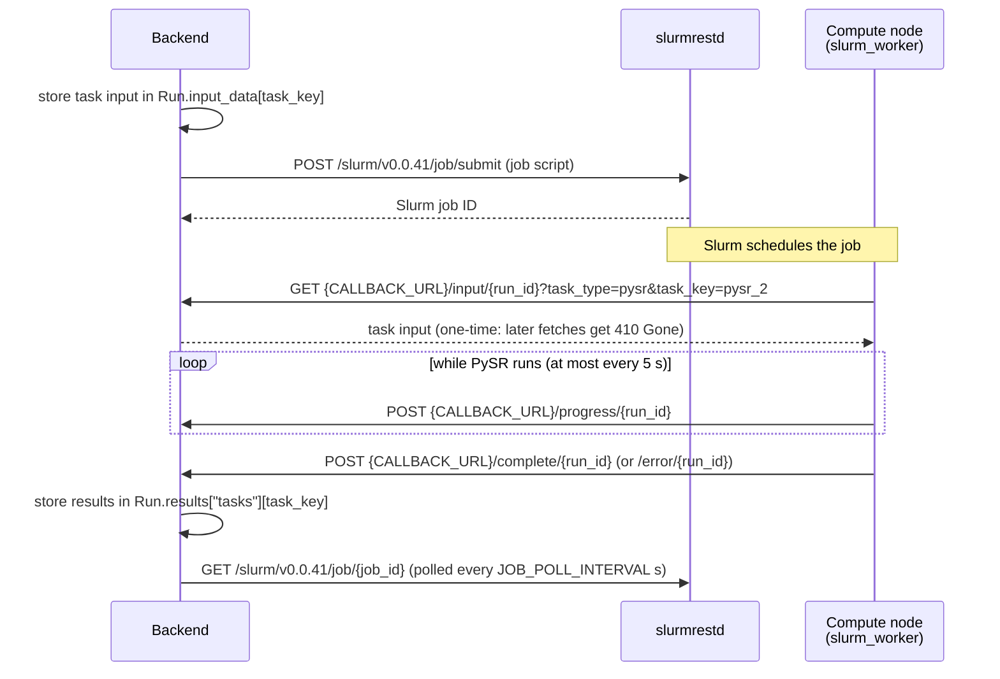

# Running Syxplain's compute on a Slurm cluster

Syxplain runs its symbolic-regression searches (PySR) as batch jobs on a Slurm cluster.
A run launches several searches, each under its own task key (`pysr_1`, `pysr_2`, ...):
a baseline search first, then targeted searches that the discovery agent in the backend
starts as it goes (see [how-it-works.md](how-it-works.md)). Everything else (profiling,
classic fits, SHAP, the LLM agent) runs inside the backend.

This guide is for the person connecting a Syxplain installation to their own cluster.
It covers the requirements, the configuration, building and deploying the worker image,
checking the setup, and troubleshooting. For the worker code itself (package layout, CLI,
adding task types) see [slurm_worker/README.md](../slurm_worker/README.md).

You do not need a cluster to develop or try Syxplain: the development compose file starts
a local Slurm emulator by default. See [Local development without a cluster](#local-development-without-a-cluster).

## Contents

- [How it works](#how-it-works)
- [Requirements](#requirements)
- [Setup](#setup)
- [Configuration reference](#configuration-reference)
- [Building the worker image](#building-the-worker-image)
- [Running without a container (conda)](#running-without-a-container-conda)
- [Verifying the setup](#verifying-the-setup)
- [Updating the worker image](#updating-the-worker-image)
- [Monitoring jobs](#monitoring-jobs)
- [Local development without a cluster](#local-development-without-a-cluster)
- [Backend on a laptop, compute on a remote cluster](#backend-on-a-laptop-compute-on-a-remote-cluster)
- [Troubleshooting](#troubleshooting)

## How it works

The backend talks to the cluster only through the
[slurmrestd](https://slurm.schedmd.com/rest.html) REST API (version `v0.0.41`). It does
not copy files to the cluster. Task input travels over HTTP in the other direction: the
job, once it runs on a compute node, fetches its input from the backend and posts
progress and results back to it.



Step by step:

1. The backend stores the search input (data table, target, predictors, PySR settings)
   in the database under `Run.input_data[task_key]`.
2. It submits a job script through `POST /slurm/v0.0.41/job/submit`. The script exports
   `CALLBACK_URL` (the backend's `WORKER_CALLBACK_URL`) and `CALLBACK_TOKEN`, then runs the
   worker, either in the Singularity image (`SLURM_CONTAINER_PATH`) or with
   `python -m slurm_worker` in a conda environment.
3. On the compute node the worker calls `GET {CALLBACK_URL}/input/{run_id}` with
   `task_type`, `task_key` and its own version, authenticated with the `X-Worker-Token`
   header. Each input can be fetched once.
4. While PySR runs, the worker posts progress to `{CALLBACK_URL}/progress/{run_id}`.
5. When the search ends, it posts the equations to `{CALLBACK_URL}/complete/{run_id}`
   (or the error to `{CALLBACK_URL}/error/{run_id}`). The backend stores the result under
   `Run.results["tasks"][task_key]`.
6. Meanwhile the backend polls the job state through slurmrestd. When the job has ended,
   it reads the result from the database. A job that has already been purged from
   slurmrestd counts as finished.

The consequence for your setup: **the compute nodes must be able to open HTTP(S)
connections to the backend.** Without a working `WORKER_CALLBACK_URL` the worker has no
input and fails with `No input source: provide --input file or configure callback URL`,
and without the completion callback the backend never receives the results.

The only things written to the cluster's file system are the job logs, PySR's scratch
files (in the node's `/tmp`), and the Julia depot (see `SLURM_JULIA_DEPOT`).

## Requirements

On the cluster (ask your cluster administrators if you are unsure):

- **slurmrestd with JWT authentication.** The cluster must run slurmrestd and accept JWT
  tokens (`AuthAltTypes=auth/jwt`), so that `scontrol token` works for your account. The
  backend uses API version `v0.0.41`, which Slurm 23.11 and later provide.
- **A cluster account** that may submit jobs, with access to a login node.
- **A shared directory** that exists on every compute node and is writable by that
  account. It becomes `SLURM_STAGING_DIR` (job logs, the Julia depot, and the worker image
  if you like). Jobs also use it as their working directory.
- **Singularity or Apptainer** on the compute nodes, to run the worker image (Apptainer
  installs a `singularity` command too). Without it, use a
  [conda environment](#running-without-a-container-conda) instead.
- **x86_64 compute nodes.** The image definition installs the x86_64 build of Julia.

Network:

| From | To | Purpose |
|---|---|---|
| Backend | slurmrestd (often port 6820) | submit, poll and cancel jobs |
| Compute nodes | Backend, at `WORKER_CALLBACK_URL` | fetch input, report progress and results |

The second direction is the one most often blocked: many clusters do not let compute
nodes open outbound connections. If yours does not, ask the administrators to allow the
backend's address (or to provide an HTTP proxy), or see the tunnel options under
[Backend on a laptop](#backend-on-a-laptop-compute-on-a-remote-cluster).

The worker image itself is built once, on a machine with Singularity or Apptainer and
`--fakeroot` (or root) and internet access, typically the cluster's login node.

## Setup

The examples use `slurm.example.org` for the login node, `<cluster-user>` for your
cluster account, and `/storage/<cluster-user>/syxplain` as the shared directory. Replace
them with your site's values.

1. **Create the shared directory** on the cluster:

   ```bash
   ssh <cluster-user>@slurm.example.org \
       "mkdir -p /storage/<cluster-user>/syxplain/containers"
   ```

2. **Generate a slurmrestd token** for the account (lifespan in seconds; your site may cap
   it):

   ```bash
   ssh <cluster-user>@slurm.example.org \
       "scontrol token username=<cluster-user> lifespan=31536000"
   ```

   The command prints `SLURM_JWT=<token>`; the part after `=` is `SLURM_AUTH_TOKEN`.

3. **Build and copy the worker image** to the shared directory, as described in
   [Building the worker image](#building-the-worker-image).

4. **Choose a callback URL and token.** `WORKER_CALLBACK_URL` is the backend's public
   base URL followed by `/api/internal`, as seen from a compute node. The token is any
   random secret, for example from `openssl rand -hex 32`.

5. **Configure the backend** in `.env`:

   ```bash
   SLURM_API_URL="http://slurm.example.org:6820"
   SLURM_AUTH_TOKEN="<token-from-step-2>"
   SLURM_USER_NAME="<cluster-user>"
   SLURM_STAGING_DIR="/storage/<cluster-user>/syxplain"
   SLURM_CONTAINER_PATH="/storage/<cluster-user>/syxplain/containers/syxplain-worker.sif"

   WORKER_CALLBACK_URL="https://syxplain.example.org/api/internal"
   WORKER_CALLBACK_TOKEN="<random-secret>"
   ```

   Set `SLURM_PARTITION`, `SLURM_CPUS`, `SLURM_MEMORY` and `SLURM_TIME_LIMIT` to suit
   your cluster (see the reference below), and `SLURM_CONTAINER_BINDS` if the shared
   directory is not the only host path the container needs.

6. **Restart the backend** and run the checks in [Verifying the setup](#verifying-the-setup).

`docker-compose.prod.yml` requires `SLURM_API_URL`, `SLURM_AUTH_TOKEN`, `SLURM_USER_NAME`
and `SLURM_STAGING_DIR`. It also bind-mounts `SLURM_STAGING_DIR` into the backend
container at the same path. If the cluster's shared storage is mounted on the backend host
at that path, the backend adds the last line of a failed job's stderr to the error it
reports; if not, the mount is an empty local directory and nothing else changes.

## Configuration reference

All settings are environment variables read by the backend (`SlurmSettings` and
`ComputeSettings` in `backend/core/config.py`). Defaults are the code defaults;
`docker-compose.prod.yml` uses `SLURM_CPUS=8` and `SLURM_MEMORY=16G` when they are unset.

### Cluster connection

| Variable | Default | Description |
|---|---|---|
| `SLURM_API_URL` | (none, required) | Base URL of slurmrestd, for example `http://slurm.example.org:6820`. The backend appends `/slurm/v0.0.41/...`. |
| `SLURM_AUTH_TOKEN` | (none, required) | JWT from `scontrol token`, sent as `Authorization: Bearer`. |
| `SLURM_USER_NAME` | `slurm` | Cluster account the jobs run as, sent as `Slurm-User-Name`. Must match the token. |

### Jobs

| Variable | Default | Description |
|---|---|---|
| `SLURM_PARTITION` | empty | Partition for the jobs. Empty means the cluster's default partition. |
| `SLURM_CPUS` | `4` | CPUs per job (`cpus_per_task`). PySR uses one worker process per allocated CPU. |
| `SLURM_MEMORY` | `8G` | Memory per job, for example `8G`, `16384M` or plain megabytes. |
| `SLURM_TIME_LIMIT` | `04:00:00` | Wall-time limit, as `HH:MM:SS`, `MM:SS` or minutes. |
| `SLURM_STAGING_DIR` | `/tmp/syxplain` | Shared directory on the cluster. Job working directory; logs go to `logs/<date>/` below it. Must exist on the compute nodes. |
| `SLURM_RETRY_INTERVAL` | `60` | Seconds to wait before resubmitting when the cluster refuses a job for quota or QOS limits (for example `QOSMaxSubmitJobPerUserLimit`). The backend keeps retrying until the run is cancelled. |

### Worker runtime

| Variable | Default | Description |
|---|---|---|
| `SLURM_CONTAINER_PATH` | empty | Path of `syxplain-worker.sif` on the cluster. Empty means no container: the job activates a conda environment named `syxplain_worker` and runs `python -m slurm_worker` (see [below](#running-without-a-container-conda)). |
| `SLURM_CONTAINER_BINDS` | `SLURM_STAGING_DIR` | Comma-separated `singularity --bind` specs, for example `/storage` or `/scratch,/data:/data:ro`. Each becomes one `--bind`. Include the directory of `SLURM_JULIA_DEPOT` if it is outside the staging directory. |
| `SLURM_JULIA_DEPOT` | `{SLURM_STAGING_DIR}/.julia` | Writable Julia depot on shared storage. Jobs run with `JULIA_DEPOT_PATH=<this>:/opt/julia-depot`, so Julia writes here and reads the packages precompiled into the image from the read-only `/opt/julia-depot`. |

### Callbacks and polling

| Variable | Default | Description |
|---|---|---|
| `WORKER_CALLBACK_URL` | empty (required) | Base URL the worker uses for input and callbacks, ending in `/api/internal`. Must use `http` or `https` and be reachable from the compute nodes. |
| `WORKER_CALLBACK_TOKEN` | empty (required) | Shared secret, passed to the job as `CALLBACK_TOKEN` and checked against the `X-Worker-Token` header. If it is unset, the backend rejects every worker request. |
| `JOB_POLL_INTERVAL` | `10` | Seconds between job-state polls. |
| `COMPUTE_MAX_RETRIES` | `3` | Retries for a failed status poll before the backend gives up on the job. |

The token and callback URL end up in the generated job script. Anyone who can read your
jobs' scripts on the cluster can read them, so use a dedicated random secret.

## Building the worker image

The worker image is defined in `slurm_worker/syxplain-worker.def`. It contains Python 3.11,
Julia 1.11.5, PySR 2.7.0 (pinned, because the backend relies on its `guesses` argument and
equation format) and the worker code under `/app/slurm_worker`. The build installs and
precompiles every Julia package PySR uses into the image and fails if that does not work.
The `%test` section then imports PySR and fits a small model offline on the read-only
image. Jobs therefore never download, resolve or compile Julia packages: the image's
environment points juliacall at the baked Julia project (`PYTHON_JULIACALL_EXE`,
`PYTHON_JULIACALL_PROJECT`).

Build on the login node (or any x86_64 machine with Singularity or Apptainer), from the
`slurm_worker` directory:

```bash
# copy the worker sources to the cluster
rsync -a --exclude __pycache__ slurm_worker/ \
    <cluster-user>@slurm.example.org:/storage/<cluster-user>/syxplain/build/src/

ssh <cluster-user>@slurm.example.org
cd /storage/<cluster-user>/syxplain/build/src
singularity build --fakeroot syxplain-worker.sif syxplain-worker.def
```

The build takes about 25 minutes, most of it Julia precompilation, and needs several GB
of temporary space. If `/tmp` on the login node is small, point the build elsewhere:

```bash
export SINGULARITY_TMPDIR=/storage/<cluster-user>/syxplain/build/tmp      # APPTAINER_TMPDIR for Apptainer
export SINGULARITY_CACHEDIR=/storage/<cluster-user>/syxplain/build/cache  # APPTAINER_CACHEDIR for Apptainer
mkdir -p "$SINGULARITY_TMPDIR" "$SINGULARITY_CACHEDIR"
```

On a long build over SSH, run it with `nohup ... > build.log 2>&1 &` or inside `tmux`
so that a dropped connection does not kill it.

If `--fakeroot` is not available to you, build on a machine where you have root
(`sudo singularity build syxplain-worker.sif syxplain-worker.def`) and copy the `.sif`
file to the cluster. The image is a single file.

Then move it to where `SLURM_CONTAINER_PATH` points:

```bash
mv syxplain-worker.sif /storage/<cluster-user>/syxplain/containers/syxplain-worker.sif
```

### Code-only rebuild

When only the worker's Python code changed (not its dependencies), `syxplain-worker-code.def`
builds a new image from an existing one in seconds. It starts from the given image
(`Bootstrap: localimage`), deletes `/app/slurm_worker`, copies in the current code and
keeps Python, Julia and the precompiled PySR stack untouched:

```bash
cd /storage/<cluster-user>/syxplain/build/src
singularity build --fakeroot \
    --build-arg base=/storage/<cluster-user>/syxplain/containers/syxplain-worker.sif \
    syxplain-worker-<version>.sif syxplain-worker-code.def
```

`--build-arg` needs SingularityCE 4 or Apptainer 1.3 or later. Use the full build when
`requirements.txt`, PySR or Julia change.

### Version

The worker version is `__version__` in `slurm_worker/__init__.py` (currently 3.2.0). The
`Version` label in the `.def` files is not kept in sync and may show an older number.
To see which version an image contains:

```bash
singularity exec syxplain-worker.sif python -c "import slurm_worker; print(slurm_worker.__version__)"
```

The worker also sends its version when it fetches its input; the backend records it in
`Run.input_data[<task_key>].worker_version`.

## Running without a container (conda)

If `SLURM_CONTAINER_PATH` is empty, the job script does this instead of `singularity run`:

```bash
if command -v conda &> /dev/null; then
    source "$(conda info --base)/etc/profile.d/conda.sh"
    conda activate syxplain_worker 2>/dev/null || true
fi
python -m slurm_worker --task-type ... --task-key ... --run-id ... --output ...
```

To prepare that environment on the cluster:

```bash
# on the login node; the environment must be visible on the compute nodes
conda create -n syxplain_worker python=3.11
conda activate syxplain_worker
pip install -r slurm_worker/requirements.txt

# install and precompile PySR's Julia packages once, here rather than in the first job
python -c "import pysr; pysr.load_all_packages()"

# the job runs in SLURM_STAGING_DIR, so `python -m slurm_worker` finds the package there
cp -r slurm_worker /storage/<cluster-user>/syxplain/
```

Notes:

- `conda` must be on the `PATH` of a non-interactive batch shell. If it is not, activation
  is skipped without an error and the system `python` runs, which then fails on missing
  modules.
- Without the image, Julia and its packages live in your home directory (`~/.julia`)
  and the conda environment. `SLURM_JULIA_DEPOT` and `SLURM_CONTAINER_BINDS` have no
  effect.
- Update the copy in the staging directory whenever the worker code changes.

The container is the better choice for production: the Julia environment is fixed at
build time and identical on every node.

## Verifying the setup

**1. Backend to slurmrestd.** From the backend host (or container):

```bash
curl -H "Authorization: Bearer $SLURM_AUTH_TOKEN" \
     -H "Slurm-User-Name: $SLURM_USER_NAME" \
     "$SLURM_API_URL/slurm/v0.0.41/ping"
```

A JSON response with `"pings"` and the Slurm version in `meta` means the URL, token and
user name work. `401` means the token is wrong, expired or issued for another user.

**2. The image.** On the login node:

```bash
singularity test /storage/<cluster-user>/syxplain/containers/syxplain-worker.sif
singularity run  /storage/<cluster-user>/syxplain/containers/syxplain-worker.sif --help
```

**3. Compute node to backend.** The callback endpoint `/health` needs no token:

```bash
srun --time=00:02:00 curl -sS https://syxplain.example.org/api/internal/health
# add --partition=<partition> if needed; use any HTTP client the nodes have if curl is missing
```

Expected: `{"status":"healthy","service":"syxplain-backend"}`. A timeout here means the
compute nodes cannot reach the backend, and every search will fail.

**4. A worker job without the backend.** `slurm_worker/example-job.sbatch` runs the image
on a local input file (`--input`), so it works without callbacks. In the copy on the
cluster, adjust its `#SBATCH --output`/`--error` paths (the directory must exist) and its
`--bind` option to your storage, then write a small input:

```bash
cat > /storage/<cluster-user>/syxplain/smoke-input.json << 'EOF'
{
  "data": {
    "columns": ["x1", "x2", "y"],
    "data": [[1, 2, 5], [2, 3, 8], [3, 4, 11], [4, 5, 14], [5, 6, 17], [6, 7, 20]]
  },
  "target_column": "y",
  "predictor_columns": ["x1", "x2"],
  "config": {"niterations": 5}
}
EOF
```

and submit it from the directory that holds the worker sources:

```bash
sbatch --export=ALL,TASK_TYPE=pysr,RUN_ID=smoke,\
INPUT_PATH=/storage/<cluster-user>/syxplain/smoke-input.json,\
OUTPUT_PATH=/storage/<cluster-user>/syxplain/smoke-output.json,\
CONTAINER_PATH=/storage/<cluster-user>/syxplain/containers/syxplain-worker.sif \
    example-job.sbatch
```

`smoke-output.json` should contain `"status": "success"` and a list of equations.

**5. End to end.** Start an analysis in the web interface. The run's activity feed shows
each search as it is submitted and its live progress; `squeue -u <cluster-user>` shows
jobs named `syxplain-<task_key>-<run id prefix>`.

## Updating the worker image

The backend and the worker image have to match: the backend passes arguments and input
fields that older workers do not know (for example, workers before 3.0 reject
`--task-key`, and the backend then reports that the image is outdated). When you update
Syxplain, rebuild the image from the same commit.

A safe order:

1. Build the new image beside the live one (full or code-only build, see above). Do not
   build over the file that `SLURM_CONTAINER_PATH` points to; running jobs use it.
2. Check it: `singularity test` and the version command, optionally the smoke job from
   [Verifying the setup](#verifying-the-setup).
3. Deploy the new backend.
4. Swap the image in, keeping the old one for rollback:

   ```bash
   cd /storage/<cluster-user>/syxplain/containers
   cp -p syxplain-worker.sif syxplain-worker.sif.bak-<old-version>
   mv -f /path/to/new/syxplain-worker.sif syxplain-worker.sif   # rename on the same file system
   ```

   Alternatively, keep versioned file names (`syxplain-worker-<version>.sif`) and change
   `SLURM_CONTAINER_PATH` together with the backend deploy.

Searches submitted between steps 3 and 4 run on the old image and may fail; the agent
reports them as failed searches and the run continues.

## Monitoring jobs

On the cluster:

```bash
squeue -u <cluster-user>                       # queued and running jobs
scontrol show job <job_id>                     # details, including the pending reason
sacct -j <job_id> --format=JobID,JobName,State,ExitCode,Elapsed,MaxRSS
scancel <job_id>                               # cancel (the backend also cancels jobs of a cancelled run)
```

Through the REST API:

```bash
curl -H "Authorization: Bearer $SLURM_AUTH_TOKEN" \
     -H "Slurm-User-Name: $SLURM_USER_NAME" \
     "$SLURM_API_URL/slurm/v0.0.41/job/<job_id>"
```

### Logs

Each job writes its stdout and stderr to a dated directory below the staging directory
(date and time in UTC):

```
{SLURM_STAGING_DIR}/logs/2026-06-15/143052_pysr_2_a1b2c3d4_e5f6g7h8.stdout
                                    HHMMSS_<task_key>_<run id>_<job uuid>   (first 8 characters of each id)
```

The worker's log messages, including the traceback of a failed task, go to `.stdout`;
PySR's and Julia's output, including the search progress bar, goes to `.stderr`.

```bash
ls /storage/<cluster-user>/syxplain/logs/$(date -u +%Y-%m-%d)/
tail -n 50 /storage/<cluster-user>/syxplain/logs/<date>/<name>.stderr
```

## Local development without a cluster

`docker compose up` starts a `mock-slurm` service next to the backend. It runs
`dev/mock_slurmrestd.py`, which answers the slurmrestd endpoints the backend uses (ping,
submit, job status, cancel) and runs the submitted jobs inside its own container. The
backend's defaults point at it (`SLURM_API_URL=http://mock-slurm:6820`,
`WORKER_CALLBACK_URL=http://backend:8000/api/internal`), so nothing needs configuring.

- **Default:** PySR searches are faked. The emulator fetches the task input from the
  backend like a real worker and returns least-squares fits of a few simple forms over
  the requested features. The image builds in seconds and needs no Julia, which is enough
  for UI and pipeline work.
- **Real PySR:** `LOCAL_PYSR=true docker compose up --build` builds Julia and PySR into
  the emulator image (the first build takes 10 to 20 minutes) and runs real searches with
  the worker code. `LOCAL_PYSR_CPUS` (default 2) sets how many CPUs each search may use.
- Task types other than `pysr` always run for real, as `python -m slurm_worker`
  subprocesses.

The repository's `slurm_worker/` directory is mounted into the emulator, so worker code
changes apply to the next job without a rebuild.

To run a worker task directly, without the backend or any Slurm:

```bash
python dev/run_worker_task.py --task classic --example 1   # classic-law screen, no Julia needed
python dev/run_worker_task.py --task pysr --example 1 --niterations 5   # needs Julia and PySR installed
```

See [slurm_worker/README.md](../slurm_worker/README.md#running-locally) for more options.

## Backend on a laptop, compute on a remote cluster

To test against a real cluster while the backend runs on your own machine, two
connections are needed: the backend must reach slurmrestd, and the compute nodes must
reach the backend.

**Backend to slurmrestd: SSH tunnel.** If slurmrestd is only reachable from inside the
cluster network, forward it through the login node. Replace `localhost` in the forward
target with the slurmrestd host if it does not run on the login node.

```bash
# backend running natively
ssh -N -L 6820:localhost:6820 <cluster-user>@slurm.example.org
# SLURM_API_URL=http://localhost:6820

# backend running in docker compose: bind on all interfaces, and use another local port,
# because the mock-slurm service already publishes 127.0.0.1:6820
ssh -N -L 0.0.0.0:16820:localhost:6820 <cluster-user>@slurm.example.org
# SLURM_API_URL=http://host.docker.internal:16820
```

Binding to `0.0.0.0` exposes the tunnel to your local network; restrict it with a
firewall or bind to the Docker bridge address instead if that matters to you.

**Compute nodes to backend: public URL.** A tunnelling service such as
[ngrok](https://ngrok.com/) gives your local backend a public address:

```bash
ngrok http 8000
# WORKER_CALLBACK_URL=https://<id>.ngrok-free.app/api/internal
# WORKER_CALLBACK_TOKEN=<random-secret>
```

This only works if the compute nodes may connect to the internet. If they can reach
the login node but not the internet, a reverse SSH tunnel to the login node can work
instead (`ssh -N -R 0.0.0.0:18000:localhost:8000 <cluster-user>@slurm.example.org`, with
`WORKER_CALLBACK_URL=http://<login-node-internal-address>:18000/api/internal`), but it
requires `GatewayPorts` to be enabled on the login node and may be against your site's
usage policy. Ask first.

## Troubleshooting

### Connecting to slurmrestd

**Connection refused or timeout**
- Check `SLURM_API_URL` (scheme, host, port) and that the backend host may connect to it.
- When tunnelling, check that the tunnel is up and, for Docker, bound to an address the
  container can reach (`host.docker.internal` with a `0.0.0.0` bind).
- Run the `ping` request from [Verifying the setup](#verifying-the-setup) from the same
  host or container as the backend.

**401 Unauthorized**
- The token has expired: generate a new one and restart the backend with it.
- `SLURM_USER_NAME` does not match the `username=` the token was issued for.

**Job submission rejected**
- `Invalid partition name`: set `SLURM_PARTITION` to a partition you may use, or leave it
  empty for the default partition.
- Memory, CPU or time requests above the partition's limits: lower `SLURM_MEMORY`,
  `SLURM_CPUS` or `SLURM_TIME_LIMIT`.
- Quota or QOS limits (job submit limit, error 2050) are not errors: the backend waits
  `SLURM_RETRY_INTERVAL` seconds and resubmits, and the run shows "Waiting for cluster
  resources".

### Jobs

**Job stays PENDING**
```bash
squeue -u <cluster-user> -l
scontrol show job <job_id> | grep Reason
```
Common reasons: `Resources` (no free nodes), `Priority` (other jobs first),
`QOSMaxJobsPerUserLimit` (too many running jobs).

**Job fails immediately, no log file**
- The staging directory is not writable by the cluster account on the compute nodes, or
  it is not on shared storage (the logs then end up on the node's local disk). The job
  script creates `logs/<date>/` itself but cannot create it without write permission.
  Check with `srun ls -ld /storage/<cluster-user>/syxplain`.

**`No input source: provide --input file or configure callback URL`**
- `WORKER_CALLBACK_URL` or `WORKER_CALLBACK_TOKEN` is empty in the backend's environment.
  Both are required.

**Input fetch fails (connection error or timeout in `.stdout`)**
- The compute nodes cannot reach `WORKER_CALLBACK_URL`. Test with the `srun curl .../health`
  command above.

**Input fetch returns 401**
- `WORKER_CALLBACK_TOKEN` differs between the backend that submitted the job and the
  backend that answers, or it is unset on the backend.

**Input fetch returns 404 or 410**
- 404: the run or its task input does not exist in the database the callback URL leads
  to. Check that `WORKER_CALLBACK_URL` points at the same installation that submitted the job.
- 410 Gone: the input was already fetched. Inputs are one-time; a job that Slurm requeued
  (after a node failure or preemption) cannot run again. The agent reports the search as
  failed and the run goes on.

**Job completes but the search reports "results missing"**
- The completion callback did not reach the backend. The worker logs failed callbacks as
  warnings (`Request to complete failed`) in `.stdout` and still exits 0. Check
  connectivity and timeouts between the compute nodes and the backend; large results
  are posted in a single request with a 30-second timeout.

**`No module named slurm_worker` (conda mode)**
- The package is `slurm_worker`. Copy the `slurm_worker/` directory into
  `SLURM_STAGING_DIR` (the job's working directory) or put it on the environment's
  `PYTHONPATH`.

**`No module named pysr`, `requests`, ... (conda mode)**
- The `syxplain_worker` environment was not activated: `conda` is not on the `PATH` of
  batch jobs, or the environment has another name.

**`unrecognized arguments: --task-key`**
- The worker image is older than the backend. Rebuild it from the backend's commit; see
  [Updating the worker image](#updating-the-worker-image).

**Job killed for memory (`OUT_OF_MEMORY`) or time (`TIMEOUT`)**
- Raise `SLURM_MEMORY` or `SLURM_TIME_LIMIT`. Memory use grows with the number of CPUs,
  because PySR starts one Julia worker process per CPU.

### Container

**`FATAL: could not open image` / image not found**
- `SLURM_CONTAINER_PATH` must be the path on the compute nodes, on storage they mount.

**Permission denied or missing files inside the container**
- The container sees only the paths in `SLURM_CONTAINER_BINDS` (default:
  `SLURM_STAGING_DIR`) plus Singularity's defaults. If `SLURM_STAGING_DIR` is a symlink,
  bind the real path as well, and include the directory of `SLURM_JULIA_DEPOT` if you
  moved it.

**Julia tries to download or compile packages at job start**
- The image was not built from `syxplain-worker.def`, or its build did not finish. A
  correct image passes `singularity test` offline. Jobs only write to the depot in
  `SLURM_JULIA_DEPOT`; delete that directory if it was filled by an older image.

**Build fails with `--fakeroot` errors**
- Your account has no subordinate UID/GID range (`/etc/subuid`, `/etc/subgid`) on that
  machine. Ask the administrators, or build as root elsewhere and copy the `.sif` over.

**Build runs out of space**
- Set `SINGULARITY_TMPDIR` and `SINGULARITY_CACHEDIR` (or the `APPTAINER_` equivalents)
  to a directory with several GB free.

## Further reading

- [configuration.md](configuration.md) and [deployment.md](deployment.md): all other
  settings, and deploying the rest of Syxplain
- [slurm_worker/README.md](../slurm_worker/README.md): the worker package, task input and
  output, adding task types
- [Slurm documentation](https://slurm.schedmd.com/documentation.html),
  [slurmrestd](https://slurm.schedmd.com/rest.html),
  [REST API reference](https://slurm.schedmd.com/rest_api.html),
  [JWT authentication](https://slurm.schedmd.com/jwt.html)
- [SingularityCE](https://docs.sylabs.io/guides/latest/user-guide/) and
  [Apptainer](https://apptainer.org/docs/user/latest/) user guides
